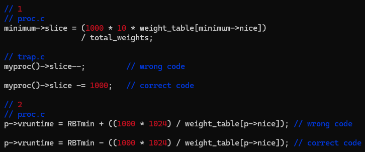

# xv6 운영체제 과제

2025년 봄학기 운영체제 수업(SWE3004)에서 수행한 과제입니다.

MIT의 교육용 운영체제 [xv6-public](https://github.com/mit-pdos/xv6-public.git) x86 버전에서 \
System Calls, CPU Scheduling, Virtual Memory, Page Replacement, File Systems을 수정하고 추가 구현했습니다.

당시 작성한 코드를 과제별로 정리했습니다. \
Project 0은 개발 환경을 설정하고 부팅 시 학번을 출력해 보는 준비 단계여서 제외하고 Project 1~5만 올립니다.

아래는 과제 설명 문서 기반해 작성했습니다. 자세한 내용은 각 프로젝트의 README를 참고해주세요.

## Projects

### [Project 1: System Calls](project1/README.md)

- Added `getnice()`, `setnice()`, and `ps()` to manage nice values and display process information.
- Connected user-space calls to kernel handlers and protected process-table access with locks.

### [Project 2: CPU Scheduling](project2/README.md)

- Implemented CFS-based scheduling using nice weights, minimum vruntime selection, and proportional time slices.
- Added timer-based runtime accounting, fork inheritance, wake-up adjustment, and scheduling statistics in `ps()`.
- Time slice units and the wake-up calculation contain errors, corrected in Project 3.

### [Project 3: Virtual Memory](project3/README.md)

- Added `mmap()`, `munmap()`, and `freemem()` with anonymous and file-backed mappings.
- Supported immediate allocation and demand paging through page fault handling and permission checks.
- Copied mappings on `fork()` and released pages and file references on unmapping.

### [Project 4: Page Replacement](project4/README.md)

- Implemented Clock replacement using a circular page list and PTE Accessed bits.
- Connected swap-out to memory allocation and swap-in to page faults, with bitmap-based slot management.
- Handled swapped pages during fork and memory release, using the skeleton's swap I/O functions.

### [Project 5: File System Extension](project5/README.md)

- Added doubly indirect blocks, increasing the maximum file size from 140 to 16,523 blocks (about 8.46 MB).
- Extended block allocation and release, updated inode layouts, and added a maximum-file-size test.
- File size extension is complete; Block Group remains unfinished.

Projects 1–3 build on the preceding work. Project 4 uses a separate course-provided skeleton, and Project 5 starts from the basic xv6 code. Each directory is built independently.

## 빌드와 실행

Linux 또는 WSL의 Linux 환경에서 실행합니다. x86 ELF를 생성할 수 있는 GCC/binutils, 32비트 빌드 지원, GNU Make, Perl, QEMU가 필요합니다.

```sh
# 실행할 과제 폴더로 이동
cd project1
make clean
make CPUS=1 QEMU=qemu-system-i386 qemu-nox
```

xv6 셸에서 Project 1·2·3·5는 `mytest`, Project 4는 `swaptest`를 실행합니다. 해당 테스트 코드는 따로 만든 거예요. QEMU 종료는 `Ctrl-a` 다음 `x`입니다.

과제 당시 개발 환경은 학교에서 제공한 리눅스 클러스터이며 별도 리눅스 환경에서는 빌드되지 않을 가능성이 큽니다.

## 결과

Project 2는 25/100, 나머지 과제는 100/100을 받았습니다.

Project 2에서 time slice 계산 단위가 맞지 않았고 vruntime 문제도 있었습니다. \
과제 요구 사항에 맞게 포맷팅을 맞추다 실수한 것 같습니다.



나중에 발견해서 Project 3에서는 수정했습니다.

Project 5는 시험 기간에 과제가 나와서 Block Group을 완성하지 못했으나 점수를 받았습니다.

## License

기반 코드의 저작권과 라이선스는 각 폴더의 `LICENSE`와 `README`를 따릅니다.
